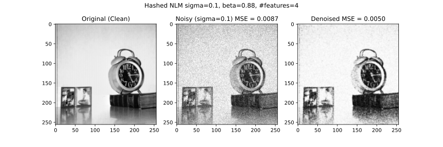
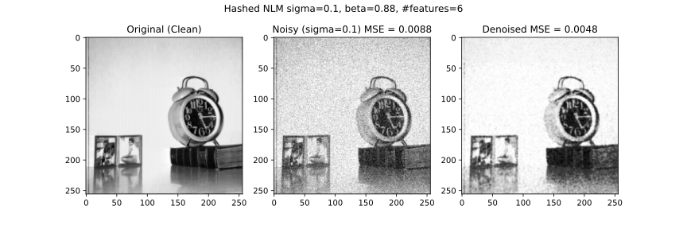
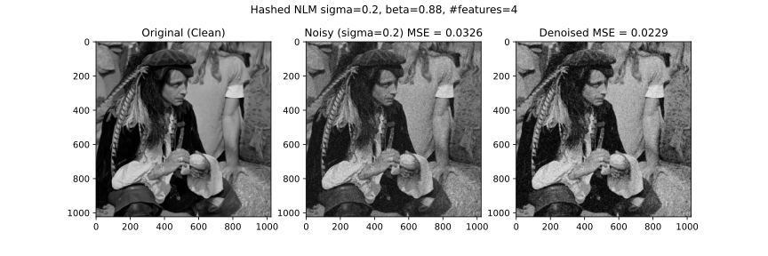

# Hashed NLM

> **Part of a larger project:** this repository is the Hashed NLM component of [**non-local-means-denoising**](https://github.com/voaidesr/non-local-means-denoising), a joint project comparing several implementations of the Non-Local Means denoising algorithm (classic NLM, Monte Carlo NLM, KD-Tree Accelerated NLM and Hashed NLM).
>
> 📄 **Paper:** [*Different Implementations of Non-Local Means Image Denoising Algorithm*](./paper/nlm-denoising.pdf) by Robu Petru-Răzvan, Verzotti Matteo-Alexandru and Voaides-Negustor Robert-Ionuț.

Implementation of Hashed Non-Local Means algorithm for image denoising.

This algorithm is a fast approximation of Nonlocal Means (NLM) denoising, based on the paper "Hashed Nonlocal Means for Rapid Image Filtering" by Dowson and Salvado. While standard NLM is often too slow for practical use due to its exhaustive search patterns, this hashed approach achieves similar performance while being significantly faster.

## Description
Traditional NLM compares a pixel's neighborhood to every other neighborhood in the image. Hashed NLM replaces this expensive search with a grid-based hash space:

- Feature Extraction: Every pixel is assigned a fingerprint based on its surrounding structure (a "star" patch)
- Hashing: Pixels are grouped into "bins" on a high-dimensional grid based on their fingerprint.
- Separable Convolution: Instead of comparing pixels one by one, the algorithm blurs the entire grid using separable convolution. This computes the weighted average for all similar pixels at once.
- Reconstruction: The denoised image is reconstructed by looking up the values in the blurred grid.

## Results





# Running instructions
Activate environment and install requirements:

```bash
python3 -m venv env
source ./env/bin/activate
pip install numpy
pip install -r requirements.txt
```

